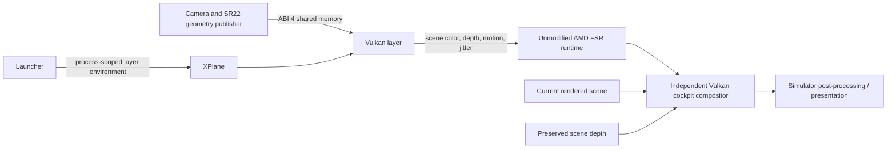

# Architecture

The launcher enables an explicit Vulkan layer only for its child process. It
checks SDK runtime hashes and conflicting proxies, and installs the owned camera
publisher with recognized-build backups. Preferences changes are separate,
explicit transactions that require X-Plane closed.

The layer recognizes supported native upscale boundaries and preserves scene
depth before the simulator can reuse it. It reconstructs camera/rigid-aircraft
motion, applies viewport jitter and calls AMD's signed runtime. Unknown buffers,
layouts and shaders bypass the effect.

The ABI 4 publisher reads only the current user's default SR22 model for the new
display profile. The OBJ parser accepts the two static G1000 device quads and
rejects animated/unsupported geometry. Attachment offsets are converted from feet
to aircraft coordinates. Projected clip vertices are published with camera data;
fast or invalid projections disable screen restoration.

After the FSR dispatch, the independent compute compositor samples the current
scene only inside those quads. It removes input jitter, compares projected and
scene depth, erodes the edge and preserves the existing output elsewhere. Its
dispatch is limited to the screen bounding region. Pipelines are per device;
uniform/descriptor resources follow the application's reusable command buffers.

Frame generation owns a separate SDK presentation path. It is deliberately not
combined with this new cockpit preview until UI composition is implemented.
No AMD shader is patched. No simulator shader/model/texture is embedded in code.
